# 🤖 NewsBot Intelligence System

**ITAI 2373 – Natural Language Processing · Mid-Term Project (Solo)**
**Author:** Mourinho Hernanto · **Date:** 20 October 2026 · **Repository:** https://github.com/Haryapandhita/ITAI2373-NewsBot-Midterm

[](https://colab.research.google.com/github/Haryapandhita/ITAI2373-NewsBot-Midterm/blob/main/ITAI2373-NewsBot-Midterm/notebooks/NewsBot_Intelligence_System.ipynb)

> 📝 **Reflective journal:** [`docs/NewsBot_Reflection_Mourinho_Hernanto.pdf`](docs/)

---

## 📌 Project Overview

NewsBot is an end-to-end NLP system that automatically processes, categorizes, and extracts insights from news articles. It integrates every technique from Modules 1–8 of ITAI 2373 into one pipeline:

| Module | Technique | What NewsBot does with it |
|---|---|---|
| 1 | NLP applications | Business framing, dataset validation and exploration |
| 2 | Text preprocessing | Contraction repair, currency tokens, stop words, lemmatization; separate raw / processed text |
| 3 | TF-IDF | Cross-validated parameter search, word clouds, chi-square feature importance |
| 4 | POS tagging | spaCy POS patterns and writing-style metrics per category |
| 5 | Syntax parsing | Dependency trees, passive voice, subject–verb–object ("who did what to whom") extraction |
| 6 | Sentiment & emotion | VADER (whole text + sentence average) and NRC emotion lexicon |
| 7 | Text classification | Leak-free scikit-learn pipeline, 5 models, feature combinations, GridSearch, error analysis |
| 8 | Named Entity Recognition | PERSON / ORG / GPE / DATE / MONEY, co-occurrence network, entity–sentiment |

---

## 💼 Business Case

**Target users:** journalists, news readers, and media analysts who need to categorize articles, monitor important entities, and identify trends across different news topics.

**What NewsBot provides:** automatic topic classification with a confidence score (low-confidence and ambiguous articles are flagged for human review), extraction of the people, organizations, places, dates and money amounts in each article, and a sentiment and emotion profile of the coverage.

See the **Business Recommendations** section of the notebook for my recommendations, their caveats, and what I would not recommend yet.

---

## 📊 Dataset

| | |
|---|---|
| **Source** | [BBC News Classification – Kaggle `learn-ai-bbc`](https://www.kaggle.com/competitions/learn-ai-bbc/data) (`BBC News Train.csv`) |
| **Size** | 1,490 rows → **1,432 articles** after removing 50 exact and 8 near-duplicates |
| **Categories** | Business (335), Sport (342), Politics (266), Entertainment (261), Tech (228) – imbalance ratio 1.50 |
| **Text** | English, median 337 words per article (min 90, max 3,345) |
| **Note** | The text is fully **lowercased** and commas/apostrophes are stripped; there is no separate title, date or source column |

The raw data is **not** included in this repository (Kaggle competition rules). The notebook downloads it with the Kaggle API (see *How to Run*).

---

## 🏗️ System Architecture

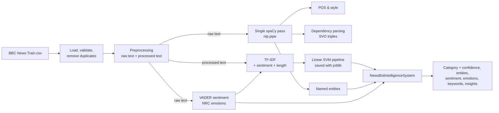

**Design highlights**
- **Two text versions:** raw text (punctuation and word order kept) for spaCy and VADER; processed text for TF-IDF and classification.
- **One spaCy pass** with `nlp.pipe()` feeds Modules 4, 5, 6 and 8; results are cached so a Colab disconnect does not require re-parsing.
- **No data leakage:** TF-IDF and scaling are fitted inside a scikit-learn `Pipeline` on training data only (also inside every CV fold); the test set is used once.
- **Same features for training and prediction:** one function (`article_feature_row`) computes the features for both, so new articles are classified exactly like training articles.
- **`SAMPLE_MODE`** flag: run on 200 articles for testing or on the full dataset for final results.

---

## 🚀 How to Run (Google Colab, free tier)

1. Click the **Open in Colab** badge above (or upload `notebooks/NewsBot_Intelligence_System.ipynb` to Colab).
2. Create a Kaggle API token and store it in **Colab → 🔑 Secrets** as `KAGGLE_API_TOKEN` (accept the `learn-ai-bbc` competition rules on Kaggle first).
3. In the setup cell, choose `SAMPLE_MODE = True` (fast test, ~200 articles) or `SAMPLE_MODE = False` (full run, ~15–20 minutes on CPU).
4. **Runtime → Run all.** Figures are saved to `results/figures/`, the trained model to `models/`.

Local alternative:

```bash
pip install -r requirements.txt
python -m spacy download en_core_web_sm
jupyter notebook notebooks/NewsBot_Intelligence_System.ipynb
```

---

## 📈 Key Results (full run, 1,432 articles)

### Classification

| Model (TF-IDF only) | CV macro-F1 | Test accuracy | Test macro-F1 | Train time |
|---|---|---|---|---|
| SVM (RBF) | 0.977 ± 0.010 | 0.955 | 0.950 | 4.5 s |
| **Linear SVM** | 0.976 ± 0.007 | **0.969** | **0.966** | 1.4 s |
| Logistic Regression | 0.969 ± 0.010 | 0.948 | 0.943 | 3.3 s |
| Naive Bayes | 0.968 ± 0.009 | 0.948 | 0.943 | 1.8 s |
| Random Forest | 0.952 ± 0.014 | 0.941 | 0.937 | 5.1 s |

**Final model:** Linear SVM (C = 1, unigrams + bigrams, `class_weight='balanced'`, calibrated) on **TF-IDF + sentiment + length** features
→ **CV macro-F1 0.980 · test accuracy 96.2% · test macro-F1 0.958** (287 held-out test articles).
Weakest class: Tech (F1 0.920). Most common confusion: Business → Politics.

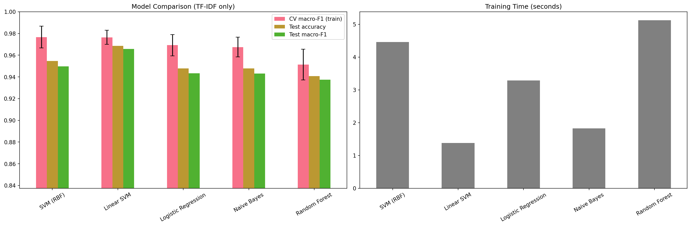
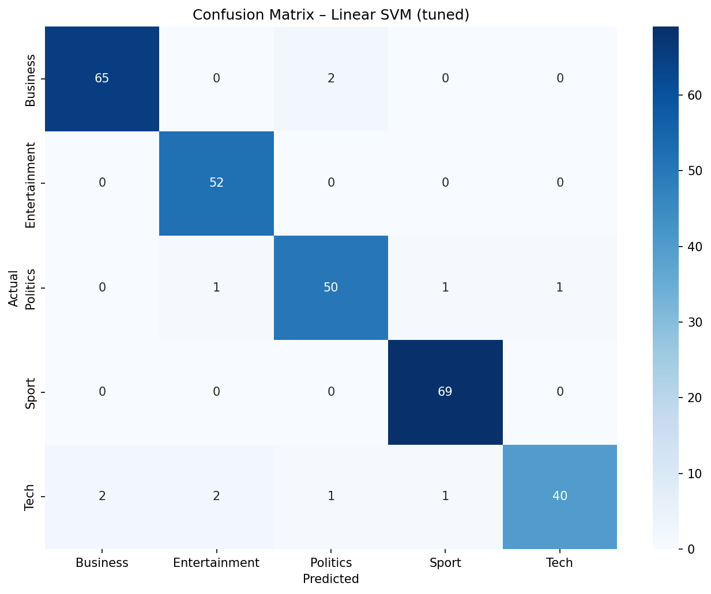

### Other findings

| Area | Result |
|---|---|
| TF-IDF | Best setting `sublinear_tf=True`: 97.5% CV accuracy (baseline 96.6%) |
| POS / syntax | Politics has the deepest parse trees and the most passive voice (27.0%); Business uses the most numbers |
| Sentiment | Entertainment most positive (sentence-average 0.192), Politics most negative (0.019); 70.4% of whole-article VADER scores saturate beyond ±0.9 |
| Emotions (NRC) | Trust is the strongest emotion in every category, anticipation second |
| NER | 26,785 focus entities (8,559 unique); most mentioned: UK, US, Britain, London |

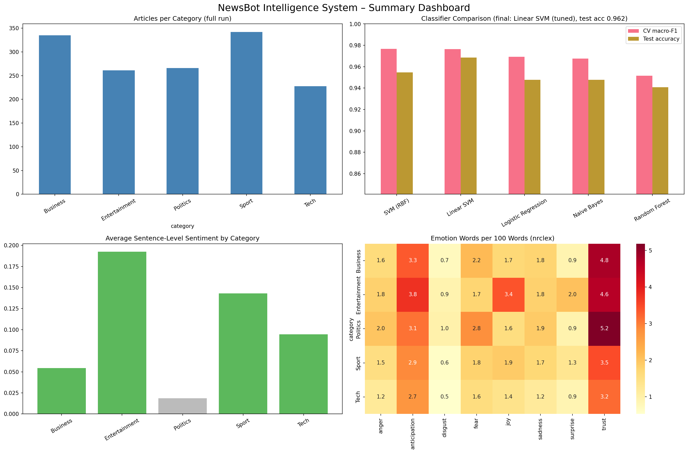

<details>
<summary>More figures</summary>

| | |
|---|---|
| 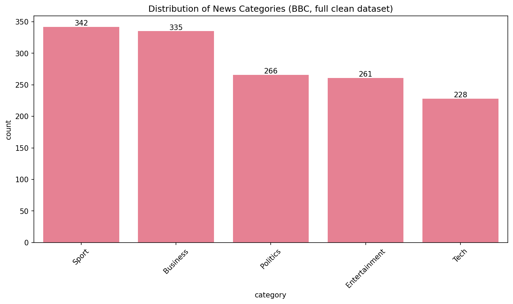 | 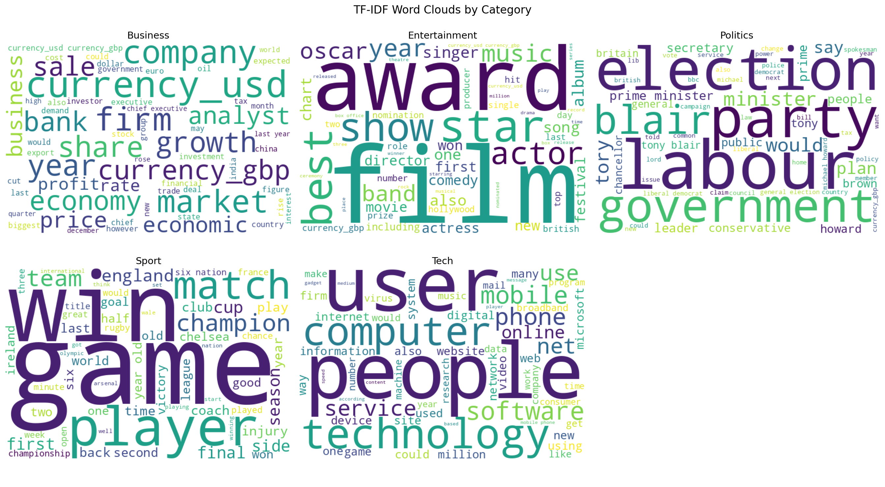 |
| 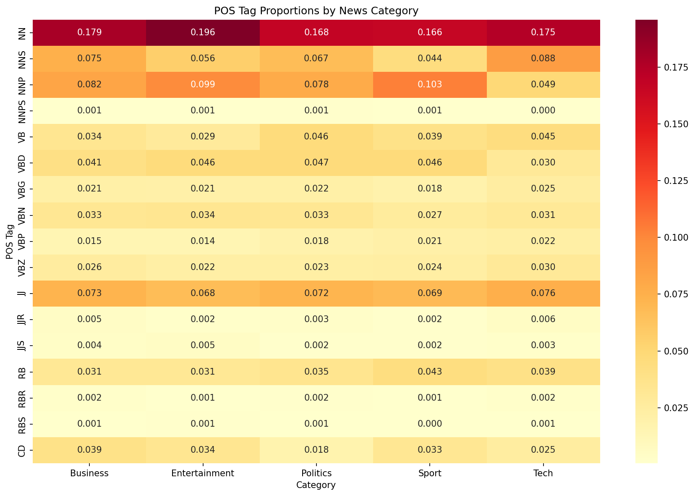 | 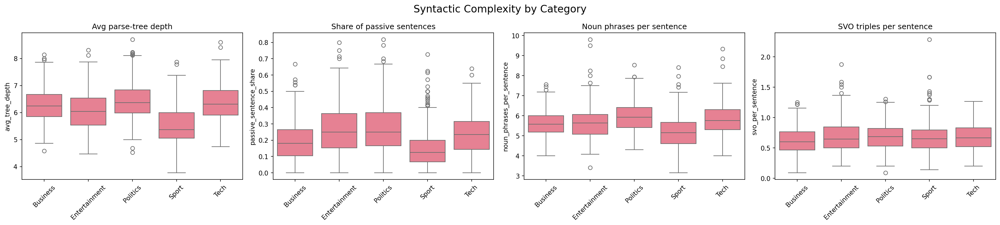 |
| 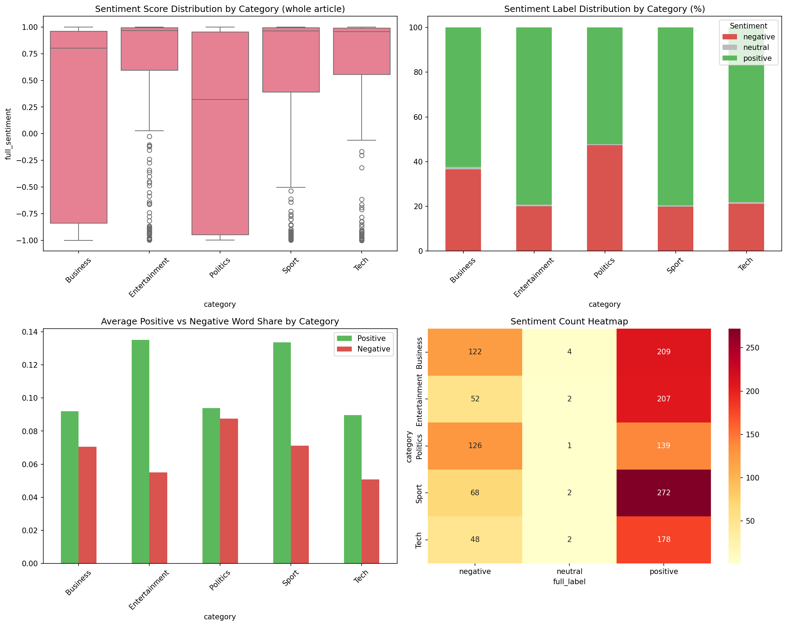 | 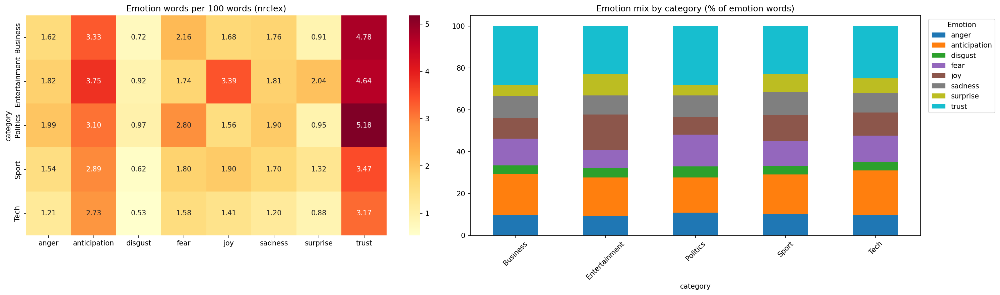 |
| 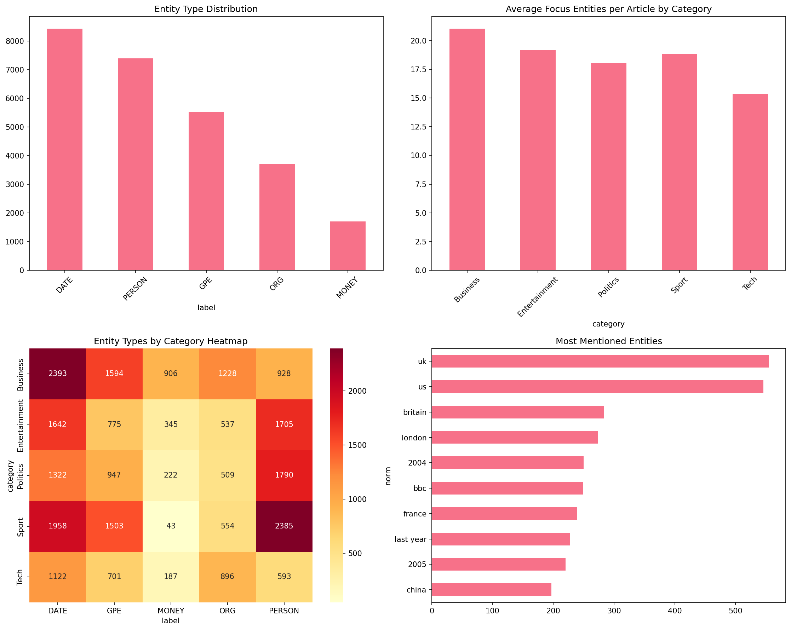 | 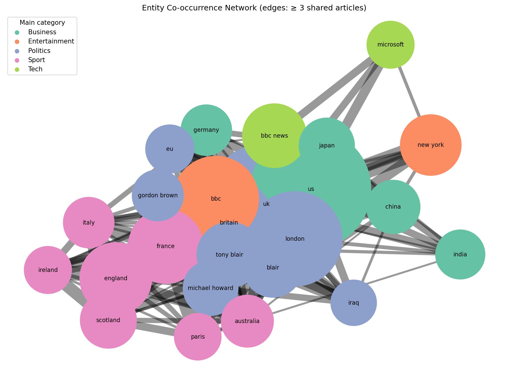 |

</details>

---

## 📁 Repository Structure

```
ITAI2373-NewsBot-Midterm/
├── README.md
├── requirements.txt
├── .gitignore
├── notebooks/
│   └── NewsBot_Intelligence_System.ipynb   # complete pipeline, Modules 1–8
├── data/
│   └── README.md                           # how to get the Kaggle data (raw data not included)
├── models/
│   ├── newsbot_classifier_full.joblib      # saved pipeline (TF-IDF + scaler + Linear SVM)
│   └── newsbot_classifier_full.json        # model metadata (parameters, scores, versions)
├── results/
│   ├── figures/                            # all exported charts
│   └── insights_summary_full.json          # facts from the comprehensive analysis
└── docs/
    └── NewsBot_Reflection_Mourinho_Hernanto.pdf   # reflective journal (2 pages)
```

**Using the saved model:** the `.joblib` file requires the same scikit-learn version it was saved with (**1.6.1**, pinned in `requirements.txt`).

---

## ⚠️ Limitations

- **Dataset:** 1,432 articles from one source (BBC), around 2004–2005, only 5 categories (articles about e.g. climate or health are forced into one of them).
- **Lowercased text without commas/apostrophes:** spaCy relies on capital letters, so proper nouns and named entities are under-detected (e.g. "Bill Gates" missed in the casing test).
- **Small spaCy model (`en_core_web_sm`):** entity and parsing errors such as "eu" labelled as PERSON.
- **VADER on news:** long articles saturate near ±1; domain words ("slam", "penalty", "party") are misread.
- **Lexicon-based emotions:** NRC counts words without context (e.g. "share" counted as trust).
- **Lemmatizer artefacts:** "aids" → "aid", "boss" → "bos", "gates" → "gate".

## 🔮 Future Work

- Retrain on data with original casing; try transformer models (e.g. BERT) for classification and NER
- Coreference resolution (38% of extracted SVO agents are pronouns) and entity linking ("uk" / "britain")
- Topic modeling, trend analysis over time (needs dated articles), and an interactive Gradio dashboard

---

## 🙋 My Contributions

This is a **solo project**, so every part of the system is my own contribution:

- **Data (Module 1):** adapted the starter notebook to the BBC dataset (column mapping, pseudo-title, removal of 50 exact and 8 near-duplicates), wrote a dataset requirement check, a text-format check (lowercasing, stripped punctuation), and data-quality analysis.
- **Preprocessing (Module 2):** contraction repair for both "don't" and BBC-style "don t", currency tokens (`£168m` → `currency_gbp`), a custom stop-word decision (keeping "won"), and separate raw / processed text versions.
- **TF-IDF (Module 3):** cross-validated comparison of 8 TF-IDF settings, word clouds, term heatmap, and chi-square feature importance on term counts.
- **Efficiency:** one cached spaCy `nlp.pipe()` pass feeding Modules 4, 5, 6 and 8, a `SAMPLE_MODE` switch for fast testing, and save/load helpers so a Colab disconnect does not require recomputation.
- **POS & syntax (Modules 4–5):** writing-style metrics, parse-tree depth, passive voice, and subject–verb–object ("who did what to whom") extraction.
- **Sentiment & emotion (Module 6):** VADER on whole articles and per sentence (to avoid saturation near ±1) and NRC emotion analysis with a fallback lexicon.
- **Classification (Module 7):** fixed the starter's Naive Bayes crash and data leakage, compared 5 models and 5 feature sets, GridSearchCV, SelectKBest, class-imbalance check, error analysis, and saved the final pipeline with joblib.
- **NER (Module 8):** entity statistics, a casing experiment, a co-occurrence network, an entity relationship graph, and entity–sentiment association.
- **Integration:** rebuilt `NewsBotIntelligenceSystem` so new articles get exactly the same features as training data, with confidence scores, ambiguity warnings, emotions and keywords.
- **Documentation:** this README, the analysis and interpretation in the notebook, and the reflective journal.

---

## 👤 About the Author

My name is Mourinho Hernanto.
I am a student at Houston City College studying Artificial Intelligence. I am interested in natural language processing because it turns large amounts of unstructured text, like news, reviews or support tickets, into information people can actually use. I am especially curious about text classification, information extraction, and how NLP systems can support human decisions instead of replacing them.

This project shows that I can build an end-to-end NLP pipeline on a real dataset: cleaning and validating messy text, comparing machine learning models with proper cross-validation, avoiding data leakage, extracting entities and sentiment, and packaging everything into a reusable system with a saved model. It also shows that I evaluate results critically, including where the system fails, such as NER errors on lowercased text and the limits of VADER on news.

- **Name:** Mourinho Hernanto
- **Course:** ITAI 2373 – Natural Language Processing
- **Contact / LinkedIn:** mourinhoreno8@gmail.com

This is a solo project: all modules, integration, documentation and reflection are my own work. AI tools were used as a learning aid for syntax, debugging and implementation approaches, as allowed by the course.

---

## 📚 References

- BBC News Classification dataset – Kaggle competition `learn-ai-bbc`: https://www.kaggle.com/competitions/learn-ai-bbc/data (originally D. Greene and P. Cunningham, "Practical Solutions to the Problem of Diagonal Dominance in Kernel Document Clustering", ICML 2006)
- spaCy – https://spacy.io
- NLTK and VADER – Hutto, C.J. & Gilbert, E. (2014). VADER: A Parsimonious Rule-based Model for Sentiment Analysis of Social Media Text. ICWSM.
- NRC Emotion Lexicon – Mohammad, S. & Turney, P. (2013). Crowdsourcing a Word–Emotion Association Lexicon. *Computational Intelligence*, 29(3). Python package: `nrclex`
- scikit-learn – Pedregosa et al. (2011). Scikit-learn: Machine Learning in Python. *JMLR* 12.
- pandas, NumPy, matplotlib, seaborn, wordcloud, plotly, networkx
